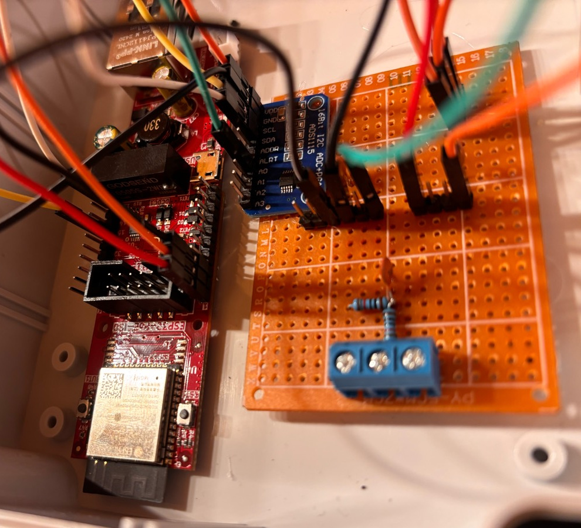
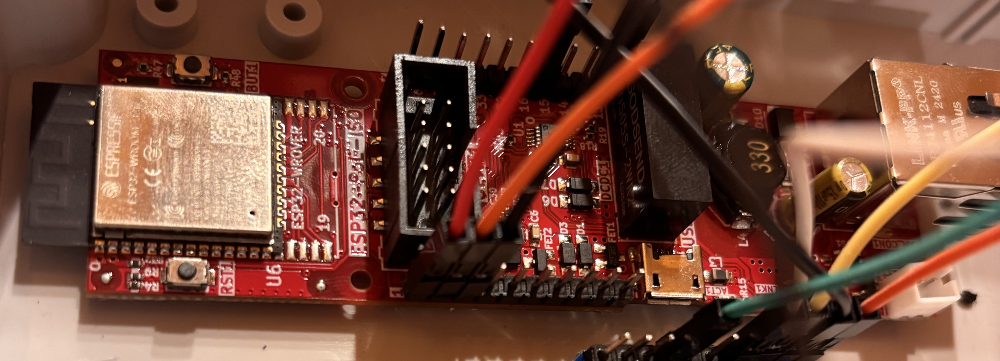
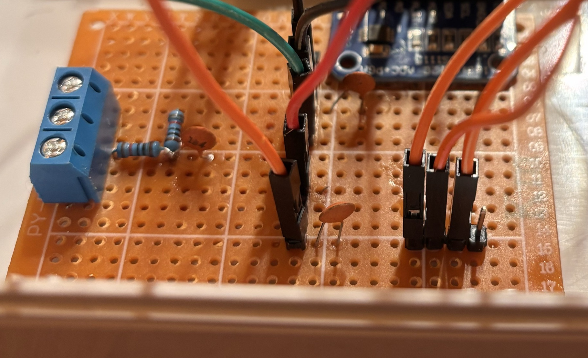
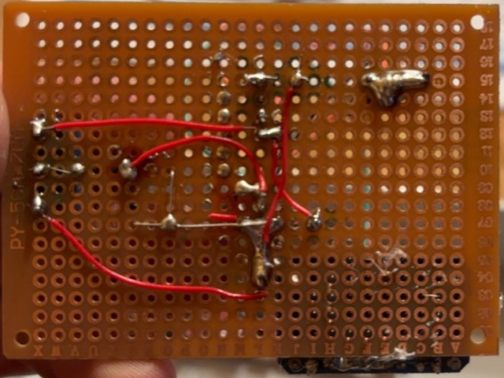
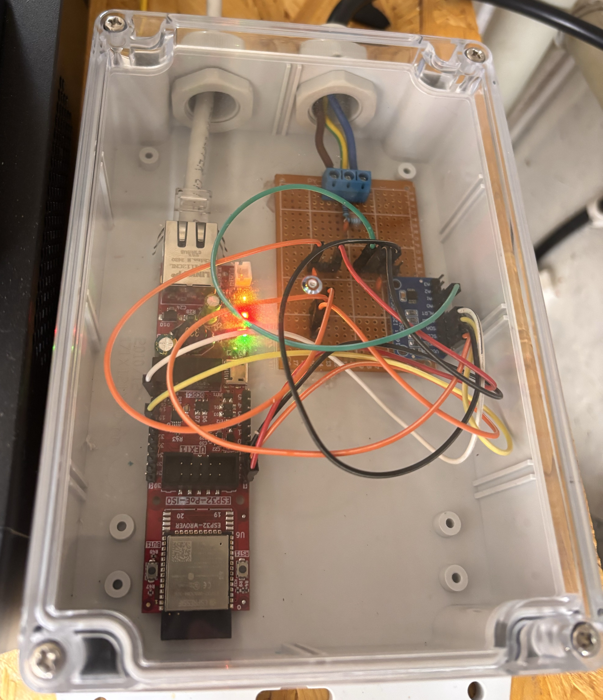

# Module photos / Zdjęcia modułu

Photographs of the assembled pressure monitoring module: internal assembly details and a view with the clear cover screwed in place. The pressure sensor itself is outside the frame. Use the wiring diagrams for connector and pin assignments.

Zdjęcia zmontowanego modułu pomiaru ciśnienia: szczegóły montażu wewnętrznego oraz widok z przykręconą przezroczystą pokrywą. Sam czujnik ciśnienia znajduje się poza kadrem. Przypisanie złączy i styków przedstawiają schematy połączeń.

The photographs were cropped and stripped of embedded metadata. Component appearance, wire colours and solder joints were not retouched.

Zdjęcia wykadrowano i usunięto osadzone metadane. Wyglądu elementów, kolorów przewodów i połączeń lutowanych nie retuszowano.

## 1. Module overview / Widok modułu

**EN:** Inside the pressure monitoring module: the Olimex ESP32-POE-ISO board and the perfboard carrying the ADS1115 and analog input circuit.

**PL:** Wnętrze modułu pomiarowego: płytka Olimex ESP32-POE-ISO oraz płytka uniwersalna z ADS1115 i torem analogowym.

## 2. Olimex board / Płytka Olimex

**EN:** The Olimex ESP32-POE-ISO board and wiring to the measurement circuit. Refer to the schematic for connector and pin assignments.

**PL:** Płytka Olimex ESP32-POE-ISO i przewody łączące ją z układem pomiarowym. Przypisanie złączy i styków przedstawiono na schemacie.

## 3. Voltage divider / Dzielnik napięcia

**EN:** The analog input circuit on perfboard: the two divider resistors, ceramic capacitors and sensor screw terminal.

**PL:** Tor analogowy na płytce uniwersalnej: dwa rezystory dzielnika, kondensatory ceramiczne i złącze śrubowe czujnika.

## 4. Solder side / Strona lutowania

**EN:** The solder side of the perfboard, showing the wire links. This photograph supplements the wiring schematic.

**PL:** Strona lutowania płytki uniwersalnej z mostkami przewodowymi. Zdjęcie uzupełnia schemat połączeń.

## 5. Module with cover / Moduł z pokrywą

**EN:** The pressure monitoring module in its enclosure with the clear cover screwed in place. The Olimex and ADS1115 boards, analog input circuit and cable entries are visible.

**PL:** Moduł pomiaru ciśnienia w obudowie z przykręconą przezroczystą pokrywą. Widoczne płytki Olimex i ADS1115, tor analogowy oraz wejścia przewodów.
